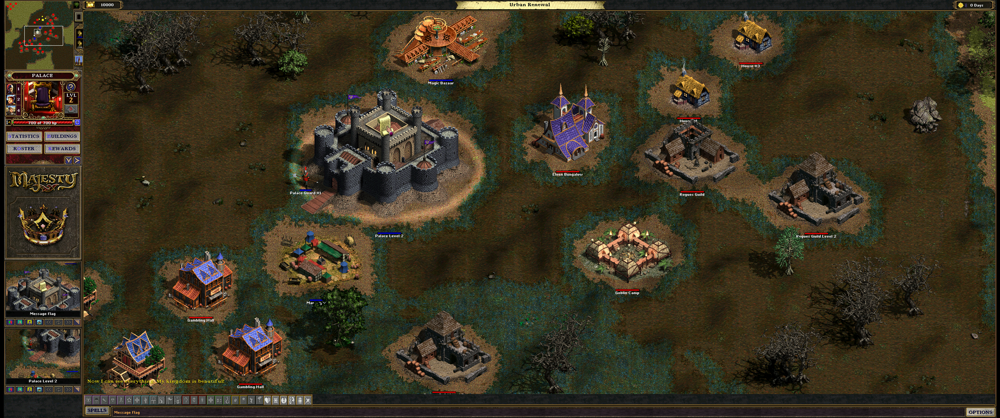

# Awesome Old Games on Modern Displays 

  
   
  <em>Majesty Gold HD (2012) at 2560x1080 with a resolution mod (by this list's author), scaled up to a 3440x1440 ultrawide monitor. The original goes up to 1920x1200.</em>

> Playing old PC games on modern displays: high and widescreen resolutions, correct aspect ratios, HUD scaling, borderless windows and working graphics on current Windows, Linux and macOS.

Old games often lock you into 640×480 or 800×600, stretch on a 16:9 or 21:9 screen, or break on modern graphics APIs. This list collects the mods, patches and wrappers that fix that.

For each game, the goal is the easiest, most widely used and best-working way to play it on a modern display: an official remaster, a source port, a patch or a mod, whichever does the job. When there are several, we list them all, and you pick.

## Contents

- [🎮 Per-game solutions](#-per-game-solutions)
- [🧰 Generic solutions](#-generic-solutions)
- [References](#references)
- [Related lists](#related-lists)

## 🎮 Per-game solutions

Mods, source ports and official patches made for one game: **[see the per-game list](per_game_solutions.md)**, sorted by game. Use Ctrl+F to find yours. The list grows by hand.

## 🧰 Generic solutions

Wrappers and fix packs that work with many games at once: **[see the generic list](generic_solutions.md)**. Start here if your game isn't in the per-game list.

## References

- [PCGamingWiki](https://www.pcgamingwiki.com) - Per-game pages with known issues and fixes, plus a library of unofficial patches.
- [Widescreen Gaming Forum](https://www.wsgf.org) - Widescreen support ratings and fixes per game.
- [VOGONS](https://www.vogons.org) - Forum for running old games on modern hardware; home of many wrappers.

## Related lists

Neighboring lists and collections with a different focus.

- [Awesome Game Remakes](https://github.com/radek-sprta/awesome-game-remakes) - Open-source remakes and source ports of classic games, many more than the few listed here.
- [Awesome Unofficial PC Ports](https://github.com/Sebastrion/awesome-unofficial-pc-ports) - Unofficial PC ports of console games.
- [Lyall's fixes](https://github.com/Lyall?tab=repositories) - Ultrawide, custom resolution and other fixes for dozens of newer games, one repository per game; many have moved to [Codeberg](https://codeberg.org/Lyall).
- [OldGameFixes](https://github.com/faithvoid/OldGameFixes) - Compilation of fixes to get older games working on newer hardware.
- [OldGamesFixes](https://github.com/Simorss/OldGamesFixes) - Compatibility fixes and patches for older games, with some Italian localization patches.
- [UltrawideIndex](https://github.com/RoseTheFlower/UltrawideIndex) - Widescreen and ultrawide solutions for more than a hundred games, mostly newer ones, by Rose of the Widescreen Gaming Forum.

## Contributing

Contributions welcome! Read the [contribution guidelines](CONTRIBUTING.md) first.

## Footnotes

- Many per-game entries were found through [UltrawideIndex](https://github.com/RoseTheFlower/UltrawideIndex) by Rose, [Lyall's fixes](https://github.com/Lyall?tab=repositories), [PCGamingWiki](https://www.pcgamingwiki.com) and the [Widescreen Gaming Forum](https://www.wsgf.org). Thanks to everyone who keeps them going.
- The screenshot at the top shows the [Majesty Gold HD Resolution Mod](https://github.com/bruno-gelb/mghd_resolution_mod), made by this list's author. The [per-game list](per_game_solutions.md) shows every other solution for Majesty next to it.
